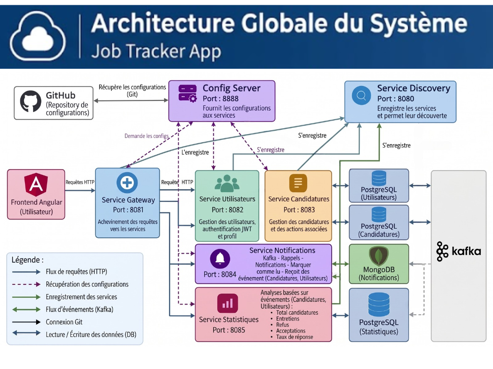
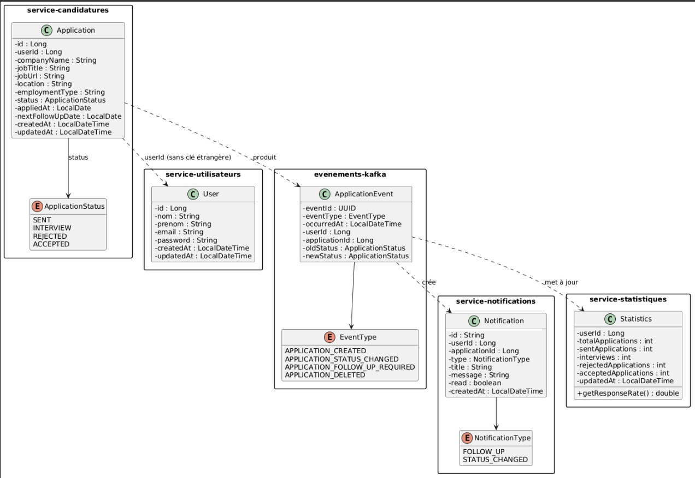

# 📌 Job Tracker App — Microservices

Application de suivi de candidatures d'emploi basée sur une **architecture microservices**. Chaque service possède sa propre responsabilité, sa propre base de données et communique via **HTTP** (requêtes synchrones) et **Kafka** (événements asynchrones).

---

## 🏗 Architecture globale

> *Schéma de l'architecture microservices du Job Tracker : Frontend Angular → Gateway → Services métier → Bases de données + Kafka.*

**Infrastructure :** Service Gateway (`8081`) · Config Server (`8888`) · Service Discovery (`8080`) · Kafka

| Service | Port | BDD | Responsabilité |
|---|---|---|---|
| **service-utilisateurs** | `8082` | PostgreSQL | Identité, authentification JWT, profil |
| **service-candidatures** | `8083` | PostgreSQL | CRUD des candidatures, statuts |
| **service-notifications** | `8084` | MongoDB | Rappels et notifications |
| **service-statistiques** | `8085` | PostgreSQL | Analyses et taux de réponse |

---

## 📐 Diagramme de classes

> *Modèle de données des services et flux d'événements Kafka.*

- **`Application`** : `id`, `userId`, `companyName`, `jobTitle`, `status`, `appliedAt`, `nextFollowUpDate`…
- **`ApplicationStatus`** (enum) : `SENT`, `INTERVIEW`, `REJECTED`, `ACCEPTED`
- **`User`** : `id`, `nom`, `prenom`, `email`, `password`, `createdAt`, `updatedAt`
- **`ApplicationEvent`** : `eventType`, `oldStatus`, `newStatus`
- **`Notification`** : `userId`, `applicationId`, `type`, `title`, `message`, `read`
- **`Statistics`** : agrégats par utilisateur (`totalApplications`, `interviews`, `rejectedApplications`…)

---

## 📨 Événements Kafka

- **`APPLICATION_CREATED`** → création d'une candidature
- **`APPLICATION_STATUS_CHANGED`** → changement de statut (`oldStatus` → `newStatus`)
- **`APPLICATION_FOLLOW_UP_REQUIRED`** → relance nécessaire

---

## 🎯 Périmètre V1

**Obligatoire :**
- **Utilisateurs** : Inscription, Connexion, JWT, Profil
- **Candidatures** : CRUD, Statuts, Filtres principaux
- **Notifications** : Kafka, Rappels, Marquer comme lue
- **Statistiques** : Total, Répartition par statut, Entretiens, Refus, Acceptations, Taux de réponse

**V2 :** Recherche avancée · Statistiques par période · Graphiques · Salaire · Localisation · Notes · Photo de profil

---

## 🛠 Stack technique

Angular · Spring Cloud Gateway · Spring Boot · JWT · Spring Cloud Config · Eureka · Apache Kafka · PostgreSQL · MongoDB

---
